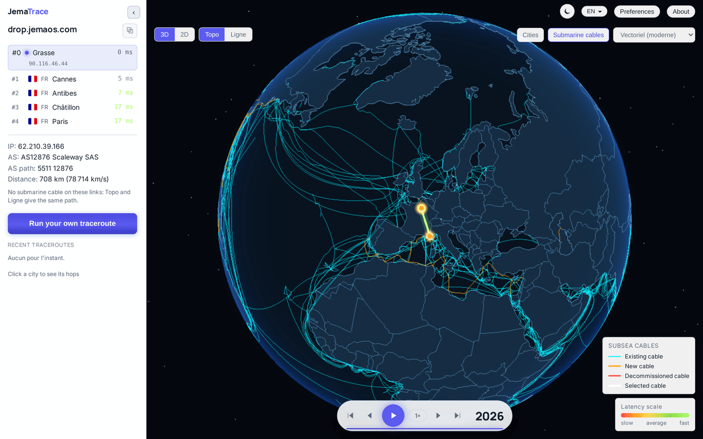
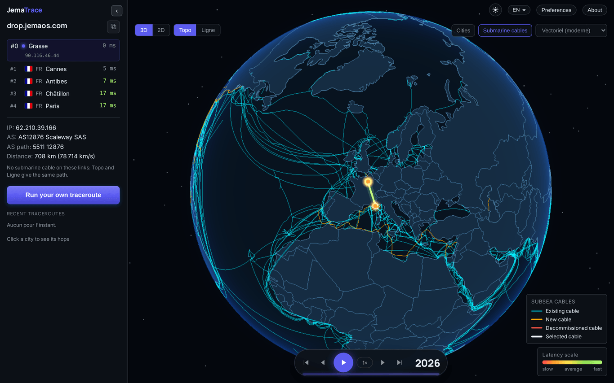
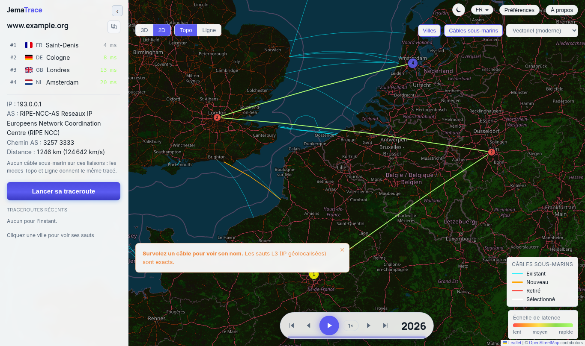
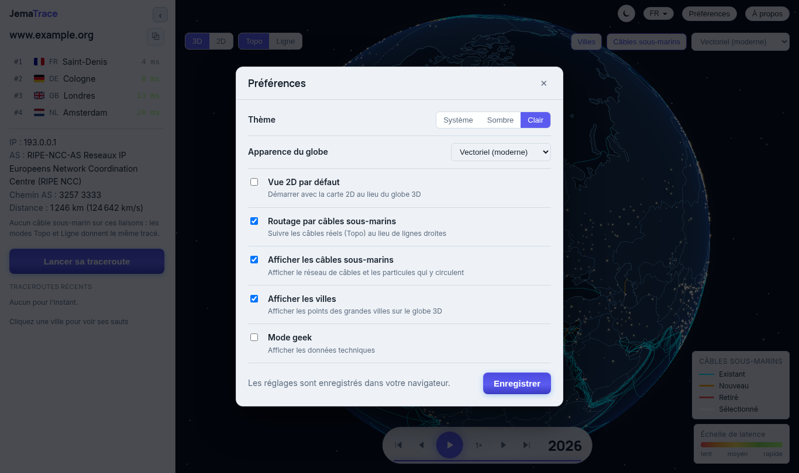
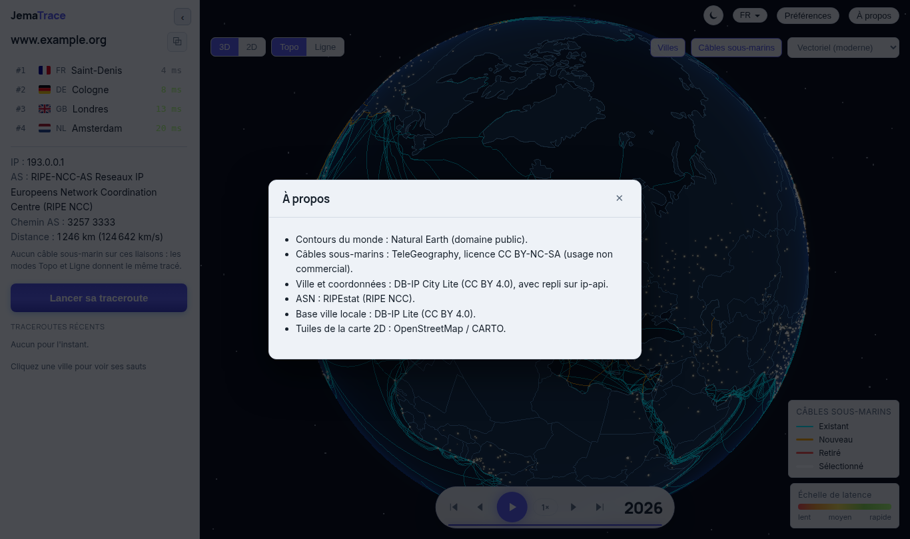
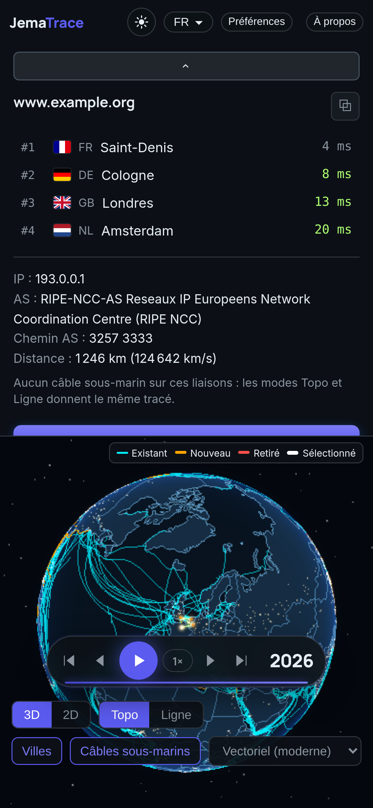
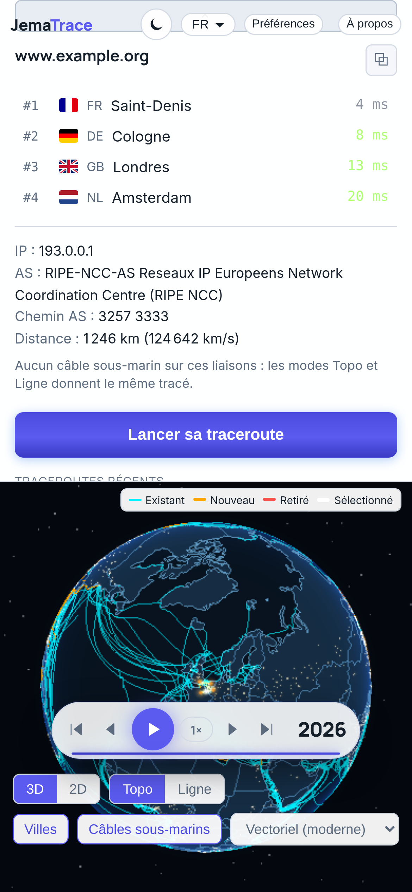

<div align="center">

<p></p>

<h1>JemaTrace</h1>

### See any traceroute on a 3D globe or a 2D map

[](https://www.jematechnology.fr)
[](LICENSE)
[](https://www.typescriptlang.org)
[](https://react.dev)
[](https://threejs.org)
[](https://fastify.dev)
[](https://jematrace.vercel.app)

**Paste a `traceroute` / `tracert` / `mtr` / `tracepath` → geolocate it → watch the path glow across a submarine-cable globe.**

▶ **Live demo: [jematrace.vercel.app](https://jematrace.vercel.app)**

[Features](#-features) · [Screenshots](#-screenshots) · [Getting started](#-getting-started) · [Architecture](#-architecture) · [License](#-license)

<br>

<sub>**Keywords:** traceroute · visual traceroute · tracert · mtr · tracepath · network map · 3D globe · hop visualization · latency map · geolocation · AS lookup · submarine cables · network diagnostics · ping path · three.js · React · TypeScript · Fastify</sub>

</div>



---

## ✨ Features

- 🌍 **3D globe & 2D map** — switch between them instantly
- 🧭 **Geolocation** of every hop (city, country, AS)
- 🌈 **Speed-coloured arcs** — latency visualized along the route
- 🧵 **Topo / Line modes** — follow the physical cable layout or a straight line
- 🛰️ **Submarine cable network** — existing, new and decommissioned cables
- 🏙️ **City lights** and multiple visual themes
- 📤 **Share & history** — shareable links, recent traceroutes
- 🔌 **API** — `POST /api/inspect` to parse & enrich a trace
- 🕵️ **No probe, no account** — the measurement comes from *your* machine

---

## 📸 Screenshots

| Light | Dark |
| :---: | :---: |
|  |  |

| 2D map | Preferences |
| :---: | :---: |
|  |  |

<p align="center">
  
</p>

### 📱 Mobile

| Dark | Light |
| :---: | :---: |
|  |  |

---

## 🚀 Getting started

### Prerequisites
- [Node.js](https://nodejs.org) **20+**

### Run (API + web)

```bash
git clone https://github.com/JemaOS/jematrace.git
cd jematrace
npm install
npm run dev        # API on :8787 + web on :5173
```

The web dev server proxies `/api` to the API (`http://127.0.0.1:8787`).

### Build

```bash
npm run build      # builds the API and the web app
```

### Tests

```bash
npm test           # Vitest
npm run typecheck  # tsc -b
```

---

## 🏗 Architecture

```
apps/
├── web/      # React + Vite + three.js (globe) + Leaflet (2D map)
└── server/   # Fastify API (/api/inspect, /api/share, /api/recent)
packages/
├── traceroute-parse/   # parse traceroute / tracert / mtr / tracepath
├── geo/                # geolocation + AS lookups
├── cable-routing/      # submarine-cable routing
├── seg-speed/          # latency → speed colouring
└── shared/             # shared types
```

**Tech stack:** TypeScript · React · Vite · three.js (`@react-three/fiber`) · Leaflet · Fastify · npm workspaces.

---

## 🤝 Contributing

Contributions are welcome! Fork, branch, and open a pull request.

```bash
git checkout -b feat/my-feature
git commit -m "feat: my feature"
git push origin feat/my-feature
```

---

## 📄 License

Released under the **MIT License** — see [LICENSE](LICENSE).

<div align="center">
Made with ❤️ by <a href="https://www.jematechnology.fr">Jema Technology</a>
</div>
